<div align="center">


<br>

[](https://github.com/Asif-Uchchas/watchtrail/actions/workflows/ci.yml)
[](LICENSE)


**Track what you watch from FTP / BDIX servers, and pick up where you left off on your phone or your PC.**

[Features](#features) | [Quick start](#quick-start) | [How to use it](#how-to-use-it) | [Deploy](#deploy-it-for-your-friends) | [Contributing](CONTRIBUTING.md)

<br>

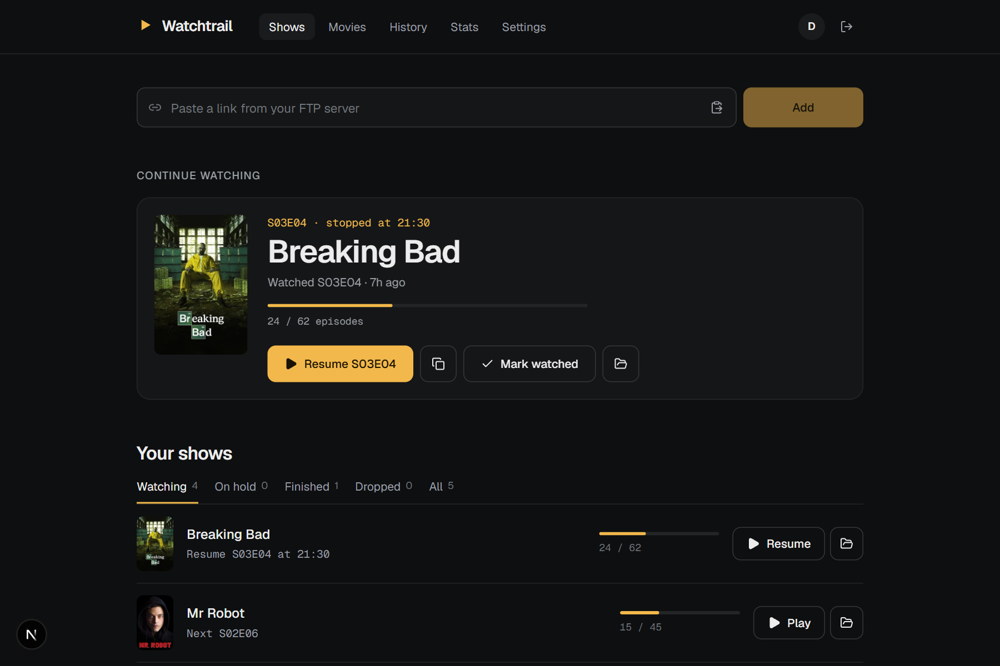

</div>

---

If you stream shows and movies from Circle FTP or another h5ai-style file server straight into VLC, you know the problem: the server has no idea what you watched. Two weeks later you are scrolling a folder of 24 files trying to remember whether you finished episode 11.

Watchtrail fixes that. Paste the link you would normally open in VLC, and it works out the show, season and episode, logs it, and gives you a **Play next** button. It stores links and small bits of metadata only. It never touches or stores video.

## Screenshots

| Show page and episode list | Stats |
|---|---|
| 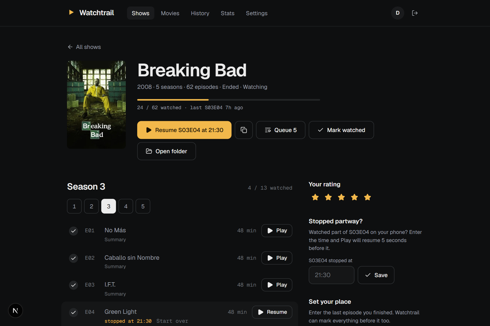 | 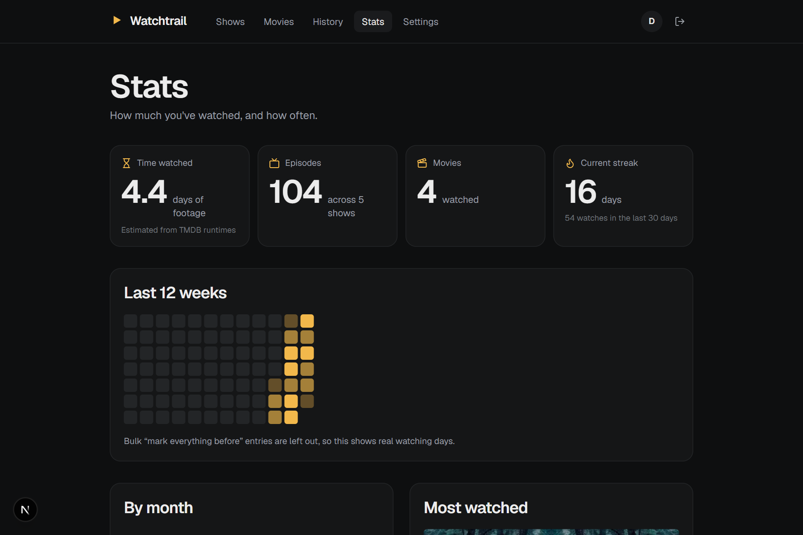 |
| **Movies** | **History** |
| 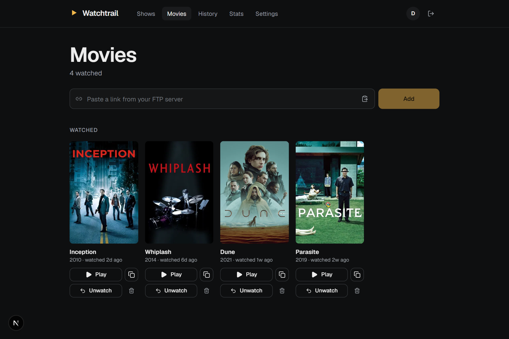 | 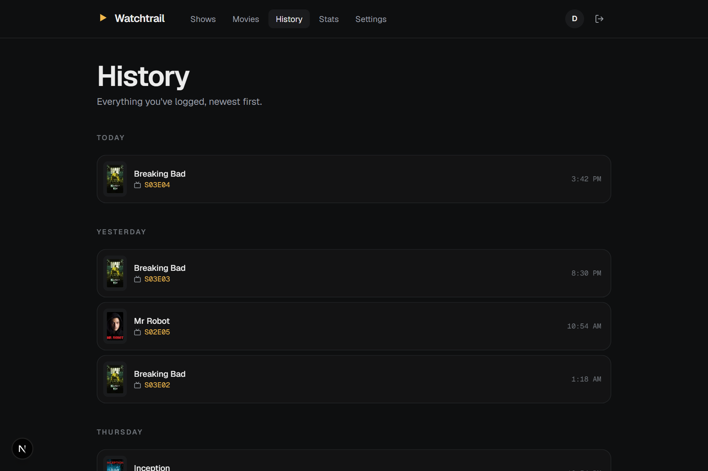 |

<div align="center">
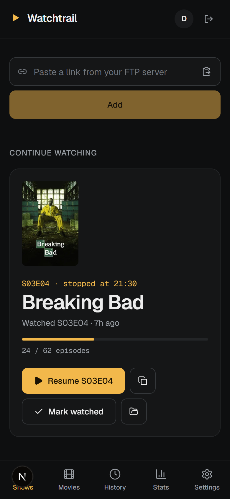
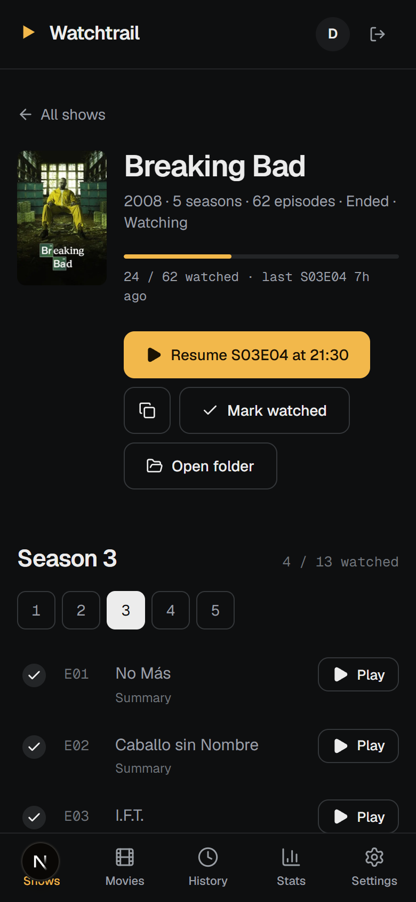
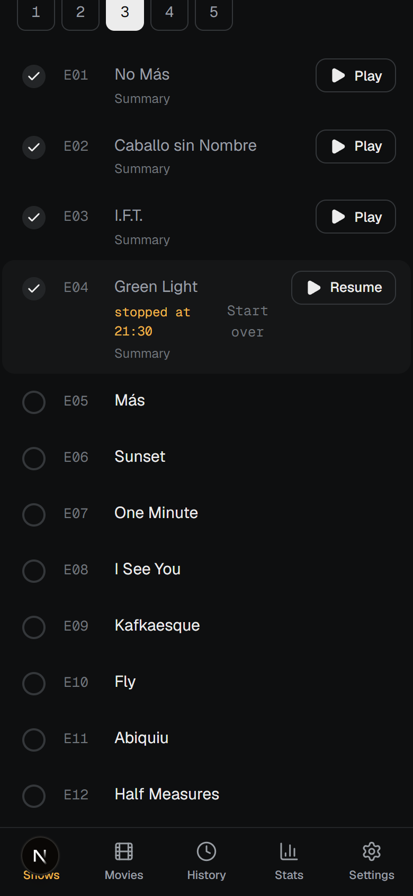
</div>

## Features

**Tracking**
- **Paste any link.** Episode files (`house.s02e05...mkv`, `2x05`, `Season 2/05.mkv`), movie files and show folders all work, with a live preview before you save.
- **Set your place.** Started a show before Watchtrail? Say "I'm at S04E10" and it marks everything before it as watched, using TMDB episode counts and rolling over seasons correctly.
- **Statuses, search, history and stats.** Watching, On hold, Finished, Dropped; a day-by-day history; watch time, streaks and top shows.
- **Undo on every action**, plus JSON backup export and import.

**Playing**
- **Play next / Resume.** One tap opens the next episode in VLC and logs it. If you stopped partway, it becomes **Resume** and starts 5 seconds before where you stopped.
- **Episode list per season** with TMDB titles and summaries (summaries are hidden until you have reached that episode, so no spoilers) and a tick to log or un-log any episode.
- **Queue 5**: a playlist of the next five episodes for VLC on desktop.
- **Real file names, learned.** With the browser helper, every folder page you open teaches Watchtrail the exact file name of each episode, so shows whose files contain the episode title still work.
- **New-episode badges** for shows that are still airing, and **star ratings**.

**Everywhere**
- Android opens VLC directly, iPhone/iPad uses VLC's URL scheme, and desktop gets a one-line `.m3u`.
- Installs to the home screen and appears in the Android **Share** menu (needs https).
- **Multi-user.** Friends can have their own accounts on the same server.
- **Browser helper** (userscript) that shows a green check or "stopped at 20:30" next to files in the FTP listing itself.
- **PC bridge** that tells Watchtrail where VLC is, so your position is saved automatically.

## Quick start

Requires **Node.js 20.9 or newer**.

```bash
git clone https://github.com/Asif-Uchchas/watchtrail.git
cd watchtrail
npm install
cp .env.example .env.local     # then set AUTH_SECRET (the command is in the file)
npm run dev                    # http://localhost:3000
```

The first account you create is yours. Data lives in a single SQLite file at `data/watchtrail.db`, created on first start. Back it up by copying that file, or use **Settings > Export** in the app.

For a production-style run use `npm run build && npm start`.

**On your phone, same Wi-Fi:** the server prints a **Network** address such as `http://192.168.0.107:3000`. Open it on your phone. If it does not load, allow Node.js through Windows Firewall for private networks. Home-screen install and the Share menu need https, so they work once deployed (below).

## How to use it

### 1. Sign up

Open the app and create an account. The first account on a fresh server is yours.

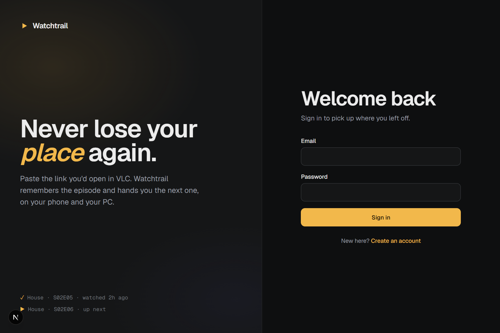

### 2. Paste a link

On the FTP site, copy an episode's link (right-click > **Copy link address**, or long-press on a phone) and paste it into the box on the home screen. Watchtrail shows what it understood (show, season, episode) before you save.

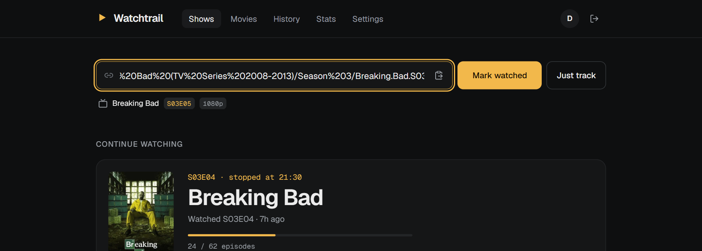

Press **Mark watched** to log it, or **Just track** to add the show without logging an episode.

### 3. Play next, resume, mark watched

The home screen keeps a **Continue watching** card for each show. **Play** opens the next episode in VLC, **Resume** continues a partly watched one, and **Mark watched** logs it without playing.


### 4. Open a show for the episode list

Every season has its own tab, with TMDB titles and spoiler-safe summaries. Tick any episode to log or un-log it. If you stopped partway, type the time into **Stopped partway?** and the episode becomes **Resume** (it starts 5 seconds earlier). Started the show before Watchtrail? Use **Set your place** to mark everything up to an episode.

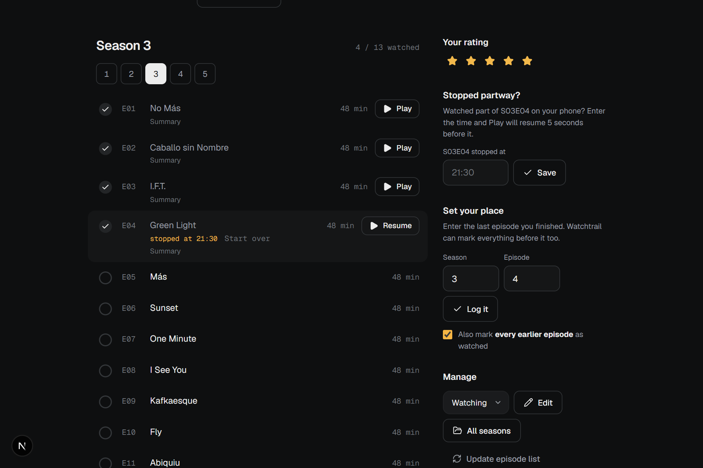

### 5. Connect the helper and bridge (optional)

**Settings** has your personal token and the one-click install for the browser helper.

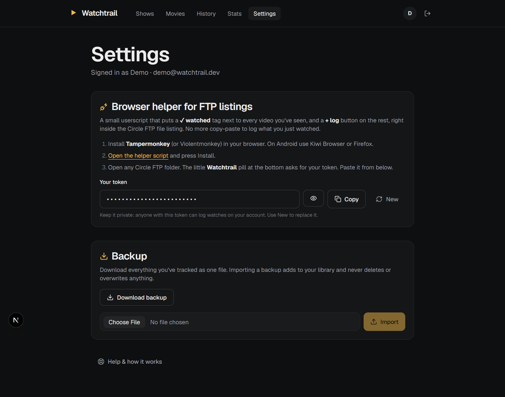

### 6. On your phone

It is a responsive web app. Add it to your home screen once it is deployed over https, or share a link straight to it from the Android **Share** menu.

<div align="center">


</div>

### Resume across devices

| You watch on | How the position is saved |
|---|---|
| **PC** with the [PC bridge](docs/VLC-BRIDGE.md) running | Automatically, every ~15 seconds and when you stop. Finished episodes (about 92% watched) are logged by themselves. |
| **Phone** | By hand: type "stopped at 21:30" on the show page. VLC on phones cannot report its position to a website. |

Android VLC and desktop playlists honour the start time. iOS VLC has no start-time option.

### Browser helper (optional, recommended)

A small userscript that adds a badge next to every video in an FTP listing and teaches Watchtrail the real file names.

1. Install [Tampermonkey](https://www.tampermonkey.net/) or Violentmonkey (on Android, use Kiwi Browser or Firefox).
2. In Watchtrail, open **Settings** and follow the helper steps (it installs from `/api/ext/watchtrail.user.js` on your server and uses your personal token).
3. Open a folder on the FTP site. Watched files get a check, partly watched ones show "stopped at", and the rest get a **+ log** button.

The script matches `circleftp.net` by default. For another server, add a `// @match *://your-server/*` line to the script header.

### PC bridge for VLC (optional)

Tells Watchtrail where you are in a file while you watch on a PC. One-time VLC setup, then double-click `scripts/watchtrail-bridge.cmd`. Full steps are in [docs/VLC-BRIDGE.md](docs/VLC-BRIDGE.md).

## Deploy it for your friends

The free tier of two services is enough for a household or a friend group.

1. **Database:** create a free database at [turso.tech](https://turso.tech) and copy its URL (`libsql://...`) and an auth token.
2. **Hosting:** push your fork to GitHub and import it on [vercel.com](https://vercel.com). `vercel.json` already picks the Mumbai region, which is close to Bangladesh. Change `regions` if you live elsewhere.
3. In Vercel's project settings add the environment variables below.
4. Deploy. Tables are created (and upgraded) on the first request.

After your friends have signed up, set `ALLOW_SIGNUPS=false` to close registration.

The hosted site never talks to the FTP servers. Your own device does the streaming, so links that only work on BDIX still play when you are on your ISP's network.

### Environment variables

| Variable | Required | Purpose |
|---|---|---|
| `AUTH_SECRET` | yes | Signs login sessions. 32+ random characters. |
| `DATABASE_URL` | no | `file:data/watchtrail.db` (default) or a `libsql://` Turso URL. |
| `DATABASE_AUTH_TOKEN` | with Turso | Turso auth token. |
| `TMDB_API_KEY` or `TMDB_READ_TOKEN` | no, but recommended | Posters, episode titles and counts, new-episode badges. Free at [themoviedb.org](https://www.themoviedb.org/settings/api). |
| `ALLOW_SIGNUPS` | no | Set to `false` to close registration. |

Without TMDB keys the app still works, but there is no artwork, no episode list with titles, and "mark everything up to here" cannot fill earlier seasons.

## Privacy

- Watchtrail stores your email, a password hash, and the links and metadata you log. No video, no FTP credentials.
- Your personal API token (used by the helper and bridge) can only log and read your own library. Rotate it any time in **Settings**.
- The bridge keeps its settings in `.watchtrail-bridge.json` in your user folder, never in the repository.

## Tech stack

Next.js 16 (App Router, React 19, server actions), TypeScript, Tailwind CSS 4, Drizzle ORM on SQLite / Turso (libSQL), signed-cookie sessions with `jose` and `bcryptjs`, TMDB for metadata. See [docs/ARCHITECTURE.md](docs/ARCHITECTURE.md) for how it fits together.

## Contributing

Bug reports, ideas and pull requests are welcome. Start with [CONTRIBUTING.md](CONTRIBUTING.md). Good first areas: parsing more file-naming styles, support for more FTP servers in the userscript, and a proper test suite for the parser.

## Show it off

Built something with it, or want to announce your fork? The project ships with the [`brag-slim`](https://github.com/latent-spaces/brag) skill. In Claude Code, run `/brag-slim` in the project folder and it writes a short launch video plus share copy to `brag-output/`.

## License

[MIT](LICENSE)
